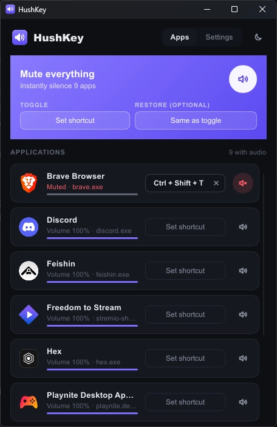

<div align="center">


# HushKey

**One keystroke to mute any app. One more to mute everything.**

Bind global shortcuts to individual applications' audio and toggle them instantly — even while a fullscreen game has focus. A tiny native tray app for Windows, macOS and Linux.

[](LICENSE.md)




</div>

---

## Features

- **Per-app mute shortcuts.** Every app with an audio session (playing *or* idle) shows up; click **Set shortcut**, press a combo, done. The same shortcut toggles mute/unmute.
- **Mute All.** One shortcut silences every app. Press it again to restore *exactly* the previous state — apps you had muted yourself stay muted. An optional second shortcut can be set to restore only. Apps that start playing while Mute All is on are silenced too.
- **Works everywhere.** Shortcuts are system-wide and fire while HushKey is hidden in the tray and while games or fullscreen apps have focus.
- **Volume and output devices.** A slider for every app and for the system volume, plus a picker to switch the default output device or send a single app to another device (e.g. Discord to the headset, music to the speakers).
- **Instant feedback.** A small, click-through on-screen confirmation (it never steals focus from your game), plus a tray-icon flash.
- **Light on resources.** Native Rust with a software-rendered UI — no browser engine. The window is destroyed when closed, so the tray-resident app holds only the tray icon, the hotkey listener and an idle audio thread. Idle CPU is zero: nothing polls while the window is hidden.
- **Safe muting.** Uses the OS mixer's own mute flag rather than setting volume to 0, so your volume levels are never lost — even if HushKey crashes.
- **Persistent.** Bindings and settings live in a small TOML file in your OS config directory.
- **Dark mode by default**, light mode toggle, launch-at-login, start-minimized.

## Platform support

| | Windows 10/11 | macOS 14.2+ | Linux |
|---|---|---|---|
| Detect apps with audio | ✅ WASAPI sessions | ✅ Core Audio process objects | ✅ PulseAudio / PipeWire sink inputs |
| Per-app mute | ✅ | ✅ via process taps | ✅ |
| Per-app volume level | ✅ | ❌ no public API ([why](docs/design-decisions.md#macos-per-app-audio)) | ✅ |
| Per-app output device | ✅ | ❌ no public API | ✅ |
| System volume & default device | ✅ | ✅ | ✅ |
| Global shortcuts | ✅ | ✅ | ✅ X11 · ⚠️ Wayland ([details](docs/design-decisions.md#wayland-global-shortcuts)) |
| Tray icon | ✅ | ✅ menu bar | ✅ StatusNotifierItem |
| Status | Tested on hardware | Compile-checked, needs testers | Compile-checked, needs testers |

## Install

Pre-built binaries will be published on the [Releases](https://github.com/X4Lo/HushKey/releases) page. Until then, build from source.

### Build from source

You need the stable [Rust toolchain](https://rustup.rs). Full per-platform notes are in [docs/building.md](docs/building.md).

**Windows**

```bash
cargo build --release
```

The binary is `target\release\hushkey.exe`. No runtime dependencies.

**macOS**

```bash
cargo build --release
```

Per-app muting needs macOS 14.2+ and the *Screen & System Audio Recording* permission. To get the permission prompt, run HushKey from an app bundle that has `NSAudioCaptureUsageDescription` set. See [docs/building.md](docs/building.md#macos).

**Linux** (Debian/Ubuntu shown)

```bash
sudo apt install build-essential pkg-config libpulse-dev libfontconfig1-dev libxkbcommon-dev
```

```bash
cargo build --release
```

Needs a PulseAudio server, or PipeWire with `pipewire-pulse` (the default on modern distros). On GNOME, the tray icon needs the *AppIndicator and KStatusNotifierItem Support* extension.

## Usage

1. Launch HushKey. It sits in the tray; click the icon to open the window.
2. Click **Set shortcut** next to an app and press a combination such as `Ctrl + Alt + S`. Letters and digits need Ctrl, Alt or Win/Cmd so normal typing isn't hijacked; F-keys can be used alone.
   - `Esc` cancels, `Backspace` removes the shortcut.
3. Set a **Mute everything** shortcut in the card at the top.
4. Close the window — HushKey keeps running in the tray. Quit from the tray menu.

Command line: `hushkey --minimized` starts in the tray; `hushkey --list` prints the detected audio apps (useful for bug reports).

## Documentation

- [Architecture](docs/architecture.md) — the `AudioController` trait, threads, and per-OS backends
- [Building](docs/building.md) — per-platform setup, packaging, permissions
- [Design decisions](docs/design-decisions.md) — why Slint, platform limitations and workarounds
- [Contributing](CONTRIBUTING.md)

## Credits

Developed by X4Lo with the help of **Claude Opus 5.5** (Anthropic), which wrote the code and documentation from X4Lo's specification.

## License

[MIT](LICENSE.md). The UI is built with [Slint](https://slint.dev), used under its Royalty-free Desktop license (attribution is shown in the app's About section).
